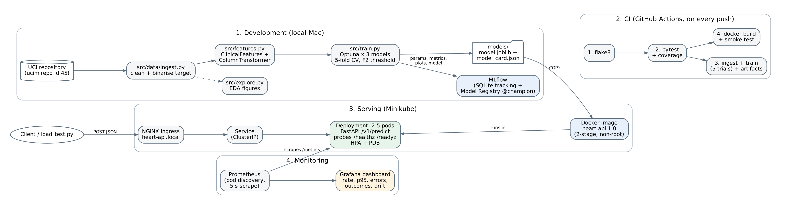

# Heart Disease Risk Classifier - MLOps Pipeline

End-to-end MLOps project for BITS Pilani AIMLCZG523 (Assignment 1): a classifier that
predicts heart disease risk from the UCI Cleveland dataset, with experiment tracking,
CI/CD, a containerised API, Kubernetes deployment and monitoring.



## Contents

| Path | What it holds |
|---|---|
| `src/data/ingest.py` | Downloads the UCI data (ucimlrepo, id 45) and cleans it |
| `src/explore.py` | EDA figures and summary, saved to `screenshots/eda/` |
| `src/features.py` | Engineered features and the preprocessing pipeline |
| `src/train.py` | Optuna tuning of 3 models, MLflow tracking, model selection |
| `src/inference.py`, `src/predict.py` | Model loading and command-line prediction |
| `src/api/app.py` | FastAPI service with validation, JSON logging and Prometheus metrics |
| `tests/` | Unit tests (pytest) |
| `.github/workflows/ci.yml` | CI: lint, tests, training run, Docker build and smoke test |
| `Dockerfile`, `requirements-serve.txt` | Serving image |
| `k8s/` | Kubernetes manifests (namespace, deployment, service, ingress, HPA, PDB) |
| `monitoring/` | Prometheus and Grafana manifests; sources in `monitoring/source/` |
| `scripts/load_test.py` | Traffic generator for the dashboard and the drift demo |
| `data/processed/` | Cleaned dataset and data report |
| `models/` | Trained pipeline and model card served by the API |
| `screenshots/` | Evidence for each phase |
| `report/` | Final report and architecture diagram |

## 1. Setup

Requirements: Python 3.12, Git. For deployment also Docker Desktop, Minikube and kubectl.
On macOS, XGBoost needs OpenMP: `brew install libomp`.

```bash
git clone https://github.com/shivanginanda7/mlops-heartdisease.git
cd mlops-heartdisease
python3.12 -m venv .venv
source .venv/bin/activate
pip install -r requirements.txt
```

## 2. Data, training and tests

```bash
python -m src.data.ingest      # download + clean -> data/processed/
python -m src.explore          # EDA figures -> screenshots/eda/
python -m src.train            # 3 models x 25 Optuna trials, about 1 minute
python -m pytest               # unit tests with coverage
python -m flake8 src tests     # lint
```

View the experiments:

```bash
mlflow ui --backend-store-uri sqlite:///mlflow.db --port 5001
# open http://127.0.0.1:5001 -> experiment "heart-disease-optuna"
```

Command-line prediction:

```bash
python -m src.predict sample_patient.json
python -m src.predict --row 0
```

## 3. Run the API locally

```bash
uvicorn src.api.app:app --port 8000
```

| Endpoint | Purpose |
|---|---|
| `POST /v1/predict` | One patient as JSON -> prediction, probability, confidence, risk band, threshold, model version |
| `GET /v1/model` | Model card of the served model |
| `GET /healthz` | Liveness |
| `GET /readyz` | Readiness (model loaded) |
| `GET /metrics` | Prometheus metrics |
| `GET /docs` | Swagger UI |

```bash
curl -X POST http://127.0.0.1:8000/v1/predict \
  -H "Content-Type: application/json" -d @sample_patient.json
```

## 4. Docker

```bash
docker build -t heart-api:1.0 .
docker run -d --name heart-api -p 8000:8000 heart-api:1.0
curl http://127.0.0.1:8000/readyz
```

## 5. Kubernetes (Minikube)

```bash
minikube start --driver=docker --cpus=4 --memory=6g
minikube addons enable ingress
minikube addons enable metrics-server
minikube image load heart-api:1.0
kubectl apply -f k8s/
kubectl -n heart-risk get pods,svc,ingress,hpa
```

In a separate terminal, keep `minikube tunnel` running, then:

```bash
curl -H "Host: heart-api.local" http://127.0.0.1/readyz
curl -X POST -H "Host: heart-api.local" -H "Content-Type: application/json" \
  -d @sample_patient.json http://127.0.0.1/v1/predict
```

Fallback without the tunnel: `kubectl -n heart-risk port-forward svc/heart-api 8080:80`
and call `http://127.0.0.1:8080`.

## 6. Monitoring

```bash
kubectl apply -f monitoring/
kubectl -n monitoring port-forward svc/prometheus 9090:9090   # terminal A
kubectl -n monitoring port-forward svc/grafana 3000:3000      # terminal B
python scripts/load_test.py --seconds 180                     # normal traffic
python scripts/load_test.py --drift --seconds 90              # drifted population
```

Grafana opens on the "Heart Disease Risk API" dashboard at http://localhost:3000
(anonymous viewer; admin / admin to edit). Prometheus targets: http://localhost:9090/targets.

## 7. CI/CD

Every push to `main` runs `.github/workflows/ci.yml`:

1. **Lint** - flake8, errors annotated on the file and line
2. **Unit tests** - pytest with coverage; JUnit and coverage reports uploaded
3. **Training run** - ingest, EDA, a 5-trial training run, model smoke test; model,
   metrics and plots uploaded as artifacts and summarised on the run page
4. **Docker** - builds the image, waits for the health check, tests `/v1/predict`
   and a 422 on invalid input

Each job only runs if the jobs it depends on passed, so any lint or test error stops
the pipeline.

## Clean-up

```bash
kubectl delete -f monitoring/ -f k8s/
minikube stop
docker rm -f heart-api
```
